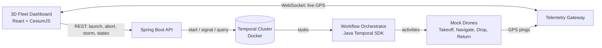

# AeroSaga: Temporal.io Autonomous Drone Mission Control

A long-running drone delivery is a multi-step process. If the connection drops or the backend crashes halfway, a normal stateless Spring Boot app loses it. AeroSaga uses **Temporal.io** so every mission is a *durable workflow*: it pauses when a drone goes offline, survives a server restart, and resumes exactly where it stopped. A 3D browser dashboard shows the fleet live.

## Architecture



| Module | What it does | Code |
|---|---|---|
| Temporal Cluster (Docker) | Persists the execution state of the workflows | `docker-compose.yml` |
| Workflow Orchestrator (Java Temporal SDK) | Deterministic mission saga: Takeoff, Navigate, Drop, Return, with compensation | `MissionWorkflowImpl`, `FleetWorkflowImpl` |
| Telemetry Gateway (Spring Boot + WebSockets) | Receives high-frequency GPS pings from the mock drones and routes them to the frontend | `TelemetryGateway`, `DroneActivitiesImpl` |
| 3D Fleet Dashboard (React + CesiumJS) | Globe with live markers plus the workflow state of every drone | `frontend/src` |

## Features mapped to the week-wise plan

| Plan item | Implementation |
|---|---|
| Temporal foundation: local cluster, first workflow and activity interface | `docker-compose.yml`, `MissionWorkflow`, `DroneActivities` |
| Mission sagas: `Promise.allOf` over many drones, `@QueryMethod` state | `FleetWorkflowImpl` (child workflow per drone), `MissionWorkflow.getState()` |
| Resiliency audit: kill the server mid-mission, workflow resumes | See "Resiliency demo" below |
| Compensation logic: failed drop triggers Return to Base | Saga in `MissionWorkflowImpl`; low battery and failed drop both trigger it |
| Signal methods: dynamic human interrupt | `emergencyAbort`, `connectionLost`, `connectionRestored` + UI buttons |
| 3D scaffolding, live telemetry, 50+ markers | `GlobeView.jsx`, WebSocket stream, "Launch 50" button |
| Workflow UI: live DAG of mission steps | `DroneCard.jsx` (Pending, Active, Completed, Failed) |
| UI state in sync with Temporal | UI polls the workflow query once per second |

## Run it

You need Docker, Java 17+, Maven and Node 18+.

```bash
# 1. Temporal server (Web UI at http://localhost:8233)
docker compose up

# 2. Backend on http://localhost:8080
cd backend
mvn spring-boot:run

# 3. Frontend on http://localhost:5173
cd frontend
npm install
npm run dev
```

Open http://localhost:5173 and click **Launch Fleet**.

Run the backend tests with `cd backend && mvn test`.

## Demo scenarios

1. **Normal fleet.** Launch 5 drones and watch the markers fly out, drop, and return.
2. **Failed drop (compensation).** Tick *Fail drone-1 drop* and launch. drone-1 fails its drop step, the saga runs *Return to Base*, and the card ends as `COMPENSATED`.
3. **Low battery.** Every 4th drone (drone-4, drone-8, ...) starts at 25% battery. It fails mid-flight and returns to base automatically.
4. **Storm (the main use case).** Click *Simulate Storm* on a flying drone. Its status becomes `OFFLINE`, the marker freezes and the workflow waits. Click *Reconnect* and the mission resumes from the step where it paused.
5. **Emergency abort.** Click *Emergency Abort*. The workflow stops and compensates by returning the drone to base (`ABORTED`).
6. **50 drones.** Click *Launch 50* and check that the globe stays smooth.

## Resiliency demo (mid-project review)

1. Launch a fleet.
2. Stop the Spring Boot process with Ctrl+C while the drones are flying.
3. Open http://localhost:8233. The workflows are still `Running`, because their state lives in Temporal.
4. Start the backend again (`mvn spring-boot:run`). The worker reconnects, the workflows continue with the next step, and the dashboard shows the drones again.

## Project structure

```
AeroSaga/
├── docker-compose.yml            Temporal server
├── README.md
├── docs/
│   ├── API.md                    REST and WebSocket reference
│   └── DEMO.md                   Demo script and screenshot checklist
├── .github/workflows/ci.yml      Backend tests and frontend build
├── backend/                      Spring Boot + Temporal Java SDK
│   ├── pom.xml
│   └── src/
│       ├── main/java/com/aerosaga/
│       │   ├── AeroSagaApplication.java
│       │   ├── TemporalConfig.java            worker, client, task queue
│       │   ├── MissionWorkflow(+Impl).java    saga, signals, query
│       │   ├── FleetWorkflow(+Impl).java      Promise.allOf over child workflows
│       │   ├── DroneActivities(+Impl).java    simulated drone
│       │   ├── BatteryPolicy.java, AeroProperties.java
│       │   ├── TelemetryGateway/Store/Point   WebSocket and GPS history
│       │   ├── MissionController, StormController, ApiExceptionHandler
│       │   └── MissionRequest, MissionLaunchRequest, MissionState, Step, ApiError
│       ├── main/resources/application.properties
│       └── test/java/com/aerosaga/            workflow, battery, store, validation tests
└── frontend/                     React + CesiumJS (Vite)
    └── src/
        ├── App.jsx, api.js, styles.css, main.jsx
        └── components/            GlobeView, DroneCard, FleetSummary, LaunchPanel
```

## Known limitations

- The drones are simulated; their position is kept in memory. After a backend restart a drone's marker restarts from the base while the workflow itself continues from the correct step.
- A signal (storm, abort) takes effect at the next leg boundary, so up to about 3 seconds after clicking.
- A new fleet can only be launched when the previous one has finished or been aborted.
- GPS history is in memory only (last 200 pings per drone).
